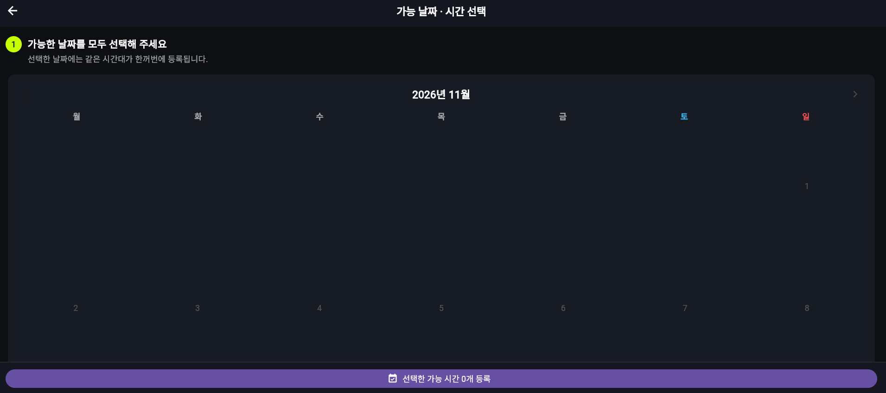
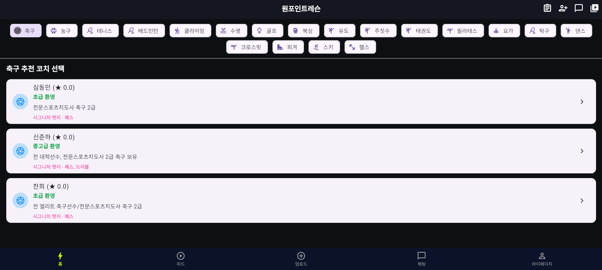
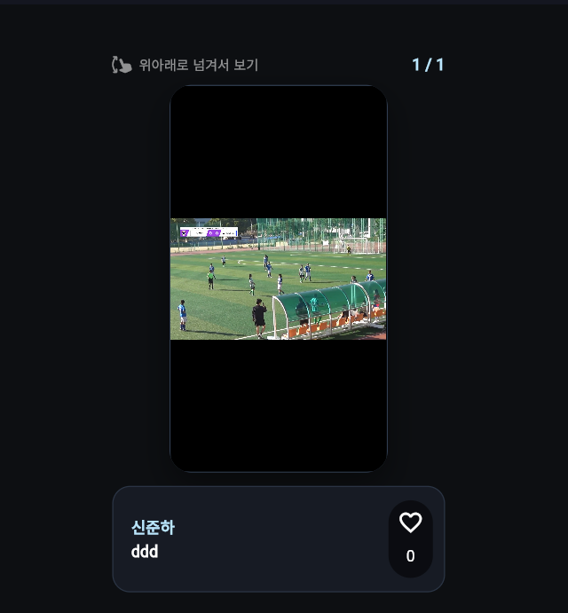
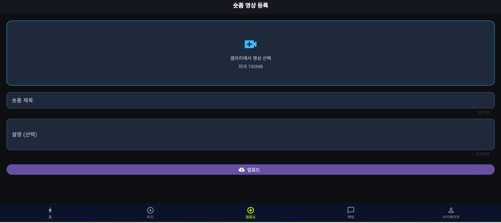

# ONEPOINT ⚽
### A Flutter & Firebase Sports Coaching Platform

**ONEPOINT** is a mobile-focused sports lesson platform under development, designed to connect students with coaches for personalized, one-on-one sports lessons.

> **Project status:** Active development. This repository is a development snapshot, not a production-ready release. Payment integration code exists, but live payment configuration and end-to-end production readiness have not been verified.

## Contribution and project scope

**Junha Shin — independent project, 6 months.** Responsible for application and backend development.

**Problem:** connecting coaches and students requires coordinated account roles, lesson availability, applications, and communication.

**Implementation:** built a Flutter client with Firebase services and server-side workflow code to support these interactions. The linked web demo and walkthrough show the current development interface.

**Portfolio contribution:** experience implementing a multi-role application and connecting client interfaces to backend services. This is a software engineering project; no machine-learning model or research evaluation is claimed.

## Overview

The application brings coach discovery, lesson availability, booking, communication, and platform administration into a single workflow. It uses Flutter for the client application and Firebase services for authentication, application data, media storage, notifications, and backend functions.

## Live demo and walkthrough

- **ONEPOINT web demo:** [Open the deployed app](https://onlyonepoint-lesson.web.app)
- **Walkthrough video:** [Watch the ONEPOINT demo](./demo/onepoint-demo.mp4) ([download the MP4](./demo/onepoint-demo.mp4))

The walkthrough is encoded at 1280-pixel width for convenient playback in the repository.

## App screenshots

A preview of the current ONEPOINT development interface. Screenshots illustrate the UI and do not by themselves verify complete end-to-end functionality.

| Sign in | Coach discovery |
| :---: | :---: |
|  |  |
| **Email and Google sign-in interface** | **Browse sports categories and recommended coaches** |

| Coach availability | Short-form upload |
| :---: | :---: |
|  |  |
| **Select available lesson dates and time slots** | **Choose a video and enter upload details** |

**Video feed**



Browse sports video content in the feed.

## Key features

| Area | Capabilities represented in the codebase |
| --- | --- |
| User accounts | Firebase authentication and student, coach, and administrator roles |
| Coaching & lessons | Coach profiles, lesson registration, availability management, and lesson applications |
| Scheduling | Coach availability and lesson date/time selection workflows |
| Messaging | Student–coach chat and notification-related services |
| Content | Short-form video feed and media upload functionality |
| Administration | Administrative dashboards and account management |
| Payments | Payment-related client and Cloud Functions code; not yet production-ready |

These are development features and modules, **not a claim that every workflow has been fully tested or released**.

## Technology stack

| Layer | Technology |
| --- | --- |
| App | Flutter, Dart |
| Authentication | Firebase Authentication, Google Sign-In |
| Database | Cloud Firestore |
| Media | Firebase Storage |
| Messaging & notifications | Firebase Cloud Messaging, Flutter Local Notifications |
| Backend | Firebase Cloud Functions (TypeScript) |
| State management | Provider |
| Video & files | video_player, image_picker, file_picker |
| Tests | flutter_test, fake_cloud_firestore, firebase_auth_mocks |

Dependencies and their declared versions are maintained in [`pubspec.yaml`](pubspec.yaml).

## Project layout

```text
ONEPOINT/
├── lib/                   # Flutter application code
├── assets/                # App assets
├── android/               # Android project configuration
├── ios/                   # iOS project configuration (when available)
├── web/                   # Web project configuration (when available)
├── functions/             # Firebase Cloud Functions
├── test/                  # Flutter tests
├── pubspec.yaml           # Flutter dependencies and assets
├── pubspec.lock           # Locked package versions
├── .gitignore             # Local/generated files and secret exclusions
└── README.md
```

## Local development

**Prerequisites:** Flutter SDK, a compatible Dart SDK, and access to a separately configured Firebase project. Platform-specific Android/iOS tooling may also be required.

```bash
flutter pub get
flutter run
```

To work on the Firebase Functions code:

```bash
cd functions
npm ci
```

Configure Firebase project settings and local environment values separately. The repository does not provide credentials or a turnkey production environment. Some local resources, including font files, were excluded from this source snapshot; restore required assets from your own licensed local copies if needed.

## Architecture at a glance

```text
Flutter client
   ├── Firebase Authentication  → sign-in and user identity
   ├── Cloud Firestore          → users, lessons, and app records
   ├── Firebase Storage         → uploaded media
   ├── Firebase Messaging       → push-notification integration
   └── Cloud Functions          → server-side workflows
```

This diagram summarizes the technologies present in the project; it is not a security or production architecture audit.

## Privacy, security & limitations

- Do **not** commit `.env` files, payment secrets, Firebase service-account credentials, signing keys, or real user data.
- Firebase client configuration and Firestore/Storage security rules should be reviewed before any public release.
- Payment-related functionality should remain in a test/development state until server-side verification, permissions, and operational checks are complete.
- Features, security controls, and deployment readiness have **not** been independently end-to-end verified.
- Generated build outputs, installed dependencies, and local-only settings are intentionally excluded from version control.

## Roadmap

- [ ] Verify core student and coach flows end to end
- [ ] Validate booking, availability, and cancellation behavior
- [ ] Review Firebase security rules and backend authorization
- [ ] Test messaging, media uploads, and notifications across devices
- [ ] Complete secure payment integration and sandbox testing
- [ ] Prepare release builds, privacy documentation, and deployment checks

## Author

**Junha Shin** — [GitHub profile](https://github.com/sinjunha513-cloud)

*Built as a hands-on mobile application and backend development project.*
