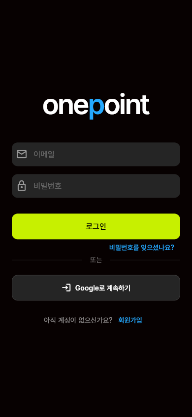
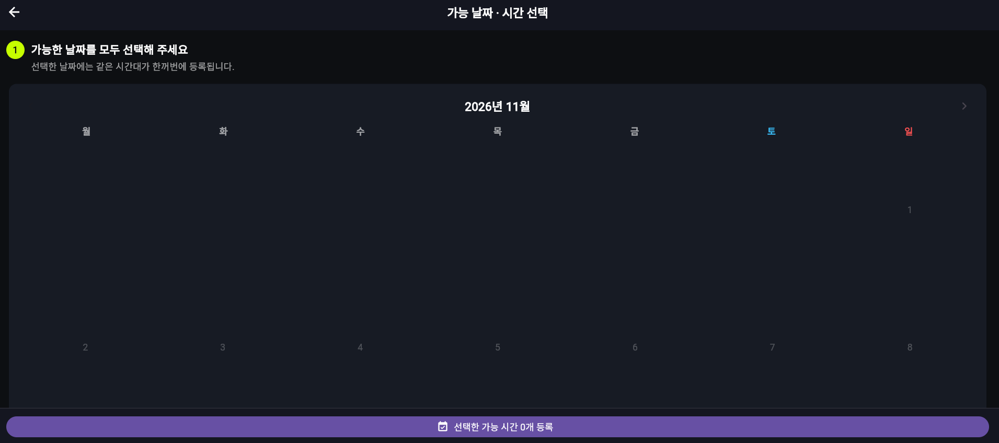
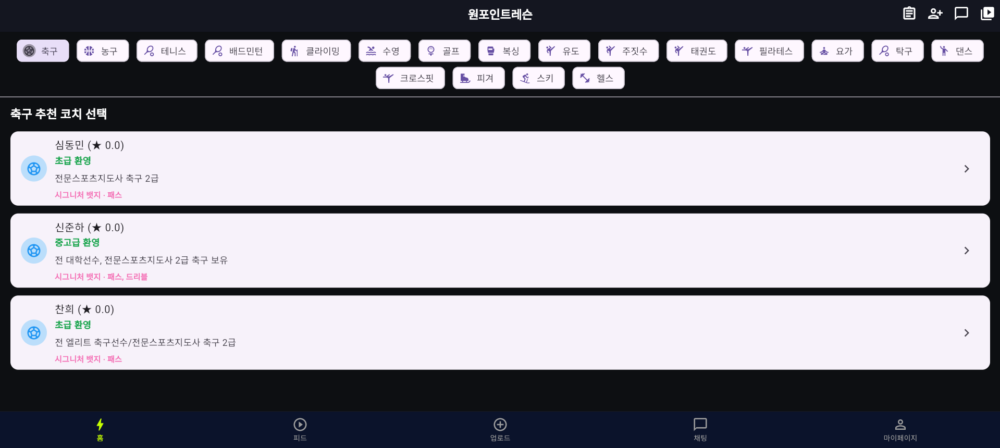
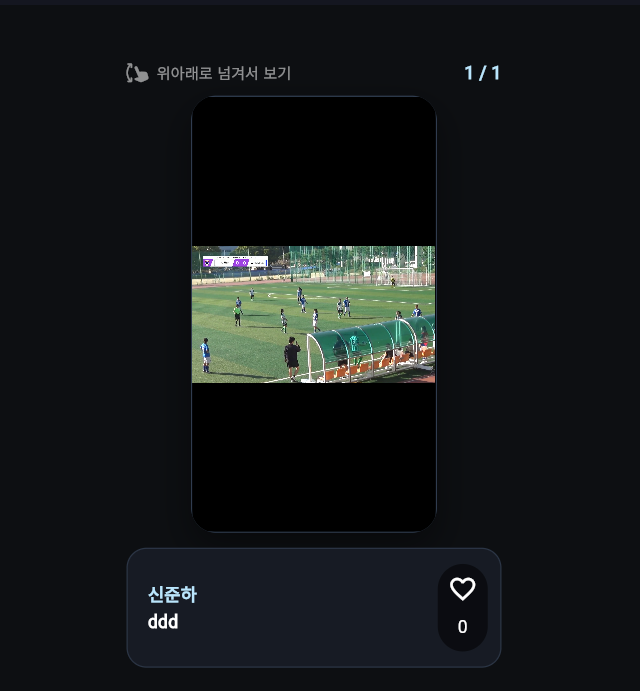
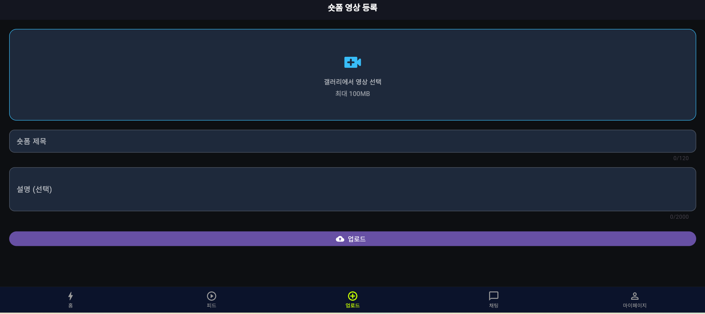

# ONEPOINT ⚽
### A Flutter & Firebase Sports Coaching Platform

**ONEPOINT** is a mobile-focused sports lesson platform under development, designed to connect students with coaches for personalized, one-on-one sports lessons.

> 🚧 **실시간 업데이트 중 · Active development**
>
> 현재 UI와 주요 기능을 지속적으로 개발·개선하고 있으며, 변경 사항을 수시로 반영하고 있습니다.
>
> **최근 업데이트 (2026-11-24 · v1.1.0):** `onepoint` 시작·로그인 로고와 애니메이션을 정리하고, 알림 설정·비밀번호 재설정·본인 확인 후 회원탈퇴·신고/차단·운영진 신고 처리를 추가했습니다. 영상은 필요한 항목만 스트리밍하며, 추천 기준과 완료 레슨에 따른 활동 점수를 안내합니다. 월간 목표는 수강생 20회이며, 달성 시 30일 유효한 10% 할인권을 받을 수 있습니다.
>
> [모바일·PC 웹에서 최신 버전 확인하기](https://onlyonepoint-lesson.web.app)

> **Project status:** Active development. This repository is a development snapshot, not a production-ready release. Payment integration code exists, but live payment configuration and end-to-end production readiness have not been verified.

## Outputs

- A Flutter/Firebase application with student, coach and administrator interfaces.
- Screens for coach discovery, lesson availability and applications, messaging and short-form video.
- A web demonstration, walkthrough video, screenshots and application/backend source code.

The linked materials show the development interface. Live payment configuration and production readiness are outside the demonstrated scope.

## Contribution and project scope

**Junha Shin — individual project, 6 months; GPT-assisted application development.** I used GPT extensively for code generation, revision, and troubleshooting while developing the application and backend. Individual project ownership refers to the project format, not to unaided implementation of every component.

**Problem:** connecting coaches and students requires coordinated account roles, lesson availability, applications, and communication.

**Implementation:** developed a Flutter client with Firebase services and server-side workflow code with GPT assistance to support these interactions. The linked web demo and walkthrough show the current development interface.

**Portfolio contribution:** practical exposure to multi-role application workflows and client–backend integration through GPT-assisted development. This is a software engineering project; no machine-learning model or research evaluation is claimed.

## Overview

The application brings coach discovery, lesson availability, booking, communication, and platform administration into a single workflow. It uses Flutter for the client application and Firebase services for authentication, application data, media storage, notifications, and backend functions.

## Live demo and walkthrough

- **ONEPOINT web demo:** [Open the deployed app](https://onlyonepoint-lesson.web.app)
- **Walkthrough video:** [Watch the ONEPOINT demo](./demo/onepoint-demo.mp4) ([download the MP4](./demo/onepoint-demo.mp4))

The walkthrough is encoded at 1280-pixel width for convenient playback in the repository.

## App screenshots

A preview of the current ONEPOINT development interface. Screenshots illustrate the UI and do not by themselves verify complete end-to-end functionality.

| Sign in | Coach discovery |
| :---: | :---: |
|  |  |
| **Email and Google sign-in interface** | **Browse sports categories and recommended coaches** |

| Coach availability | Short-form upload |
| :---: | :---: |
|  |  |
| **Select available lesson dates and time slots** | **Choose a video and enter upload details** |

**Video feed**



Browse sports video content in the feed.

## Key features

### Account, community and media release (2026-11-24)

- **Brand:** native `onepoint` wordmark in the existing Inter font, black/white/blue Figma palette, startup fade/slide, and reduced-motion support. Existing launcher icons are retained.
- **Notifications:** private activity inbox plus opt-in browser Web Push and native FCM registration; account-owned devices, logout cleanup, preview privacy and invalid-token removal. Historical inbox sync does not resend old activity as push notifications. iOS/iPadOS web notifications require a web app added to the Home Screen. Real-device delivery still requires device permission and acceptance testing; native iOS also requires APNs configuration.
- **Account recovery and withdrawal:** email password reset with a neutral result, recent password/Google reauthentication for withdrawal, and a server queue that disables access, removes personal uploads/messages and anonymizes retained shared lesson records. Pending or active lessons must be resolved first. Administrator accounts use the existing managed account workflow.
- **Community operations:** report members/videos, privately block/unblock members, and stop new bookings/messages between blocked accounts. Administrators can dismiss, warn or hide reported videos with a reason and recorded history; reports do not automatically impose a permanent ban.
- **Media:** cursor pages of 20 public feed summaries, bounded initial chat history with older-message loading, one active video player and 15-minute server-authorized streaming URLs. Private feedback remains limited to actual lesson participants and administrators.
- **Honest progress and recommendations:** confirmed completions give 20 activity EXP; likes and evaluation scores do not inflate the tier. Student learning and coach teaching totals are distinct. Coach recommendations explain their sport/experience/goal matching criteria and do not claim an AI success probability or an uncollected review rating.
- **Student rewards:** 20 completed lessons in the current Korean calendar month unlock one 10% coupon, valid for 30 days from claim. Coaches do not receive this reward; the platform fee covers the discount while preserving coach settlement. Live payment activation remains a separate task.

Validation and deployment evidence are recorded in `docs/deployment/2026-11-24-platform-finalization.json` and `docs/deployment/2026-11-24-final-hosting.json`.

### Lesson workflow (2026-11-23)

- **Booking:** multiple dates with the same coach; overlap checks for both participants, including when a coach takes another coach's lesson. Unscheduled duplicate applications to the same coach remain blocked until a date is agreed.
- **Response deadline:** ordinary pending applications expire at the earlier of 24 hours after application or lesson start. A scheduled job checks every five minutes; booking/acceptance also checks expiry immediately.
- **Date changes:** the original booking stays in place while the proposed slot is held for up to 24 hours (or its start/application deadline). Only the counterparty can approve or reject; the requester can withdraw. Approval swaps slots atomically; rejection, withdrawal or expiry releases the hold.
- **Cancellation:** either participant can cancel an ordinary accepted lesson before it starts, with a required reason. Pending applications can be withdrawn. Cancellation releases only the slots still linked to that lesson.
- **Completion:** after the agreed end time, the coach submits attendance and evaluation; only student confirmation finalizes the lesson and awards its progress once. Students can dispute attendance, including a no-show without a coach submission. Administrators can record a reason to confirm supported attendance, reopen discussion or cancel without awards. A coach cannot overwrite an unresolved dispute.
- **Integrity:** callable-only state changes, participant calendar locks, revision checks for stale responses and participant/admin-readable workflow history. Existing payment workflows are excluded from these ordinary-lesson changes.

| Area | Capabilities represented in the codebase |
| --- | --- |
| User accounts | Firebase authentication and student, coach, and administrator roles |
| Coaching & lessons | Coach profiles, lesson registration, availability management, and lesson applications |
| Scheduling | Coach availability and lesson date/time selection workflows |
| Messaging | Student–coach chat and notification-related services |
| Content | Short-form video feed and media upload functionality |
| Administration | Administrative dashboards and account management |
| Payments | Payment-related client and Cloud Functions code; not yet production-ready |

These are development features and modules, **not a claim that every workflow has been fully tested or released**.

## Technology stack

| Layer | Technology |
| --- | --- |
| App | Flutter, Dart |
| Authentication | Firebase Authentication, Google Sign-In |
| Database | Cloud Firestore |
| Media | Firebase Storage |
| Messaging & notifications | Firebase Cloud Messaging, Flutter Local Notifications |
| Backend | Firebase Cloud Functions (TypeScript) |
| State management | Provider |
| Video & files | video_player, image_picker, file_picker |
| Tests | flutter_test, fake_cloud_firestore, firebase_auth_mocks |

Dependencies and their declared versions are maintained in [`pubspec.yaml`](pubspec.yaml).

## Project layout

```text
ONEPOINT/
├── lib/                   # Flutter application code
├── assets/                # App assets
├── android/               # Android project configuration
├── ios/                   # iOS project configuration (when available)
├── web/                   # Web project configuration (when available)
├── functions/             # Firebase Cloud Functions
├── test/                  # Flutter tests
├── pubspec.yaml           # Flutter dependencies and assets
├── pubspec.lock           # Locked package versions
├── .gitignore             # Local/generated files and secret exclusions
└── README.md
```

## Local development

**Prerequisites:** Flutter SDK, a compatible Dart SDK, and access to a separately configured Firebase project. Platform-specific Android/iOS tooling may also be required.

```bash
flutter pub get
flutter run
```

To work on the Firebase Functions code:

```bash
cd functions
npm ci
```

Configure Firebase project settings and local environment values separately. The repository does not provide credentials or a turnkey production environment. Inter and Pretendard font files are bundled with their OFL license notices under `assets/fonts/`.

## Architecture at a glance

```text
Flutter client
   ├── Firebase Authentication  → sign-in and user identity
   ├── Cloud Firestore          → users, lessons, and app records
   ├── Firebase Storage         → uploaded media
   ├── Firebase Messaging       → push-notification integration
   └── Cloud Functions          → server-side workflows
```

This diagram summarizes the technologies present in the project; it is not a security or production architecture audit.

## Privacy, security & limitations

- Do **not** commit `.env` files, payment secrets, Firebase service-account credentials, signing keys, or real user data.
- Firebase client configuration and Firestore/Storage security rules should be reviewed before any public release.
- Payment-related functionality should remain in a test/development state until server-side verification, permissions, and operational checks are complete.
- Features, security controls, and deployment readiness have **not** been independently end-to-end verified.
- Generated build outputs, installed dependencies, and local-only settings are intentionally excluded from version control.

## Roadmap

- [ ] Verify core student and coach flows end to end
- [ ] Validate booking, availability, and cancellation behavior
- [ ] Review Firebase security rules and backend authorization
- [ ] Test messaging, media uploads, and notifications across devices
- [ ] Complete secure payment integration and sandbox testing
- [ ] Prepare release builds, privacy documentation, and deployment checks

## Author

**Junha Shin** — [GitHub profile](https://github.com/sinjunha513-cloud)

*Built as a hands-on mobile application and backend development project.*
